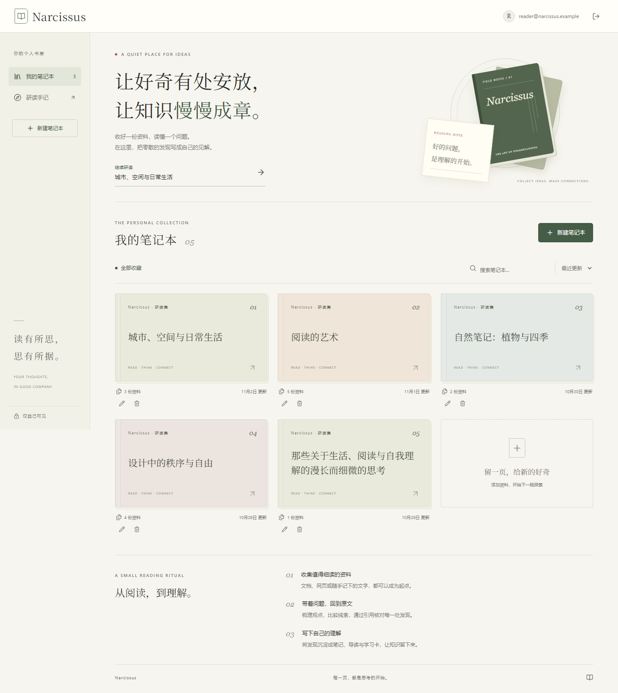

# Narcissus

从阅读到理解。Narcissus 是面向中文资料的个人知识工作台：收集资料、带着问题阅读、核对引用，再把理解整理成笔记、学习卡和图文内容。



## 当前版本

项目现已更新为 Next.js + FastAPI 的完整应用。暖白纸面、墨绿点缀、书册封面与中文衬线标题贯穿书房、登录与阅读工作区；手机端可切换资料、对话和创作。

- 账号登录、私有笔记本、搜索、排序、分页与资料管理。
- PDF、DOCX、文字、网页、图片与 OCR 导入，引用定位与原文预览。
- 多轮问答、Markdown 阅读、笔记、总结和内容导出。
- 思维导图、闪卡、测验、音频概览、联网研究、演示文稿与信息图。
- PostgreSQL / pgvector、MinIO / S3、Redis / Celery，Docker Compose 部署。

## 快速启动

```sh
cp .env.example .env
# 填写聊天模型、向量模型等配置，并设置独立密码
docker compose up -d --build
```

Windows PowerShell 使用 `Copy-Item .env.example .env`。启动后打开 [localhost:3000](http://localhost:3000)。模型、搜索与语音功能需要各自的有效服务配置；源码不包含真实密钥或用户业务数据。

已有运行环境只更新前端：

```sh
docker compose up -d --build --no-deps web
```

升级现有安装时保留原私有 `.env`、Compose 项目标识和持久化卷，先确认备份。默认的新安装项目名为 `narcissus`。仅部署前端到旧后端时，可在私有配置中指定 `BACKEND_REQUEST_MARKER`，代理只转换应用自身的有效请求标识，来源与会话检查仍由后端执行。

## 项目目录

```text
frontend/            Next.js 页面、组件、同域 API 代理
backend/app/         FastAPI 业务服务与 Celery 任务
backend/migrations/  Alembic 数据库迁移
backend/tests/       后端与集成测试
deploy/              反向代理示例
scripts/             备份与恢复脚本
docs/                架构、功能与验证说明
compose.yaml         应用容器配置
```

## 文档与验证

- [界面改版与验证](docs/EDITORIAL-REDESIGN.md)
- [部署配置](docs/DEPLOYMENT.md)
- [架构与 API](docs/ARCHITECTURE.md)
- [图文创作](docs/VISUALS.md)
- [音频概览](docs/AUDIO.md)
- [学习功能](docs/LEARNING.md)
- [资料导入](docs/V5-SOURCES.md)
- [联网研究](docs/V6-RESEARCH.md)
- [开发交接](AGENT_HANDOFF.md)

界面截图使用隔离示例数据。历史验证文档记录特定版本与环境的结果，不表示新安装已完成配置或所有模型服务均可用。
