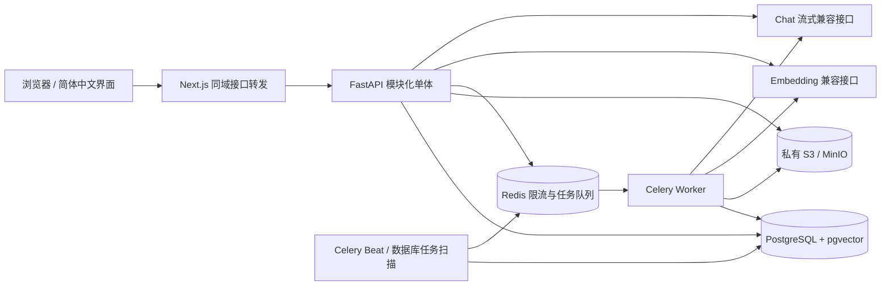

# Narcissus架构与接口（第二版）

## 运行结构

数据库保存所有业务事实。Redis 不作为任务唯一记录：每个任务先进入 PostgreSQL outbox，Beat 每 10 秒调度。
后端独立模块：`auth/security/access`、`notebooks`、`documents/storage/pdf_processing/tasks`、`conversations`、`qa/retrieval/model_service`、`writings/generation/exports`。
前端接口访问集中在 `lib/api.ts`，工作台状态在 `hooks/use-workspace.ts`，复用组件在 `components/`，路由页面在 `app/`。原文使用 PDF.js 本地 Worker 在画布中显示；字体/CMap/解码资源随构建打包，PDF 内容通过鉴权接口读取。引用切换真实页码，不依赖浏览器内置 PDF 查看器；不执行 PDF 内的脚本或链接动作。可另开原文件页面。

## 数据模型与删除

| 表 | 主要字段 | 约束/关系 |
|---|---|---|
| users | UUID、email、password_hash | 邮箱唯一；Argon2id 哈希 |
| login_sessions | HMAC token_hash、user_id、expires_at | 服务端可撤销会话，用户删除级联 |
| notebooks | user_id、name、updated_at、deleted_at | 每次访问限定所有者；软删除立即不可见 |
| documents | notebook_id、object_key、filename、status、generation、pages | 对象键唯一；每笔记本默认最多 10 份有效资料 |
| jobs | document_id、kind、generation、claim、attempts、status、error、usage | 同资料/种类/版本唯一；删除资料后 ID 置空保留任务审计 |
| chunks | UUID、document_id、page、ordinal、text、embedding | 文档/页/片段号唯一；文档删除级联 |
| conversations | notebook_id、title、updated_at | 笔记本删除级联 |
| messages | conversation_id、in_reply_to、role、content、status、generation、source_ids、usage | 每会话最多一个生成中消息；关联原问题用于重试 |
| citations | message_id、chunk_id、label | 同一消息编号唯一；关联真实原文片段，原片段删除级联 |

主键使用 UUID 字符串；所有外键、状态查询、任务调度与更新时间建立相应索引。初始结构冻结在 Alembic `001` 和 SQL 快照中，不依赖后续 ORM 定义变化。

第一版最多约 8,000 个片段/笔记本，使用 pgvector 精确余弦距离排序，先做所有者、笔记本、资料与模型版本约束。**没有建立 ANN/HNSW 索引**：在第一版范围内用精确查询保持过滤与结果稳定，避免过早引入近似索引调参。向量已持久化并可查询；后续规模扩大再按模型维数建立分区或表达式 HNSW 索引。

上传先创建 `uploading` 元数据记录，再持行锁写对象存储，成功后在同一事务建立 `queued` 任务。中断的上传由扫描器清理。解析、分块和向量调用在事务外执行，最终写回时再次锁资料并验证 `generation + claim + deleted_at`，一个事务替换全部片段并置为 `ready`。

删除在事务内写墓碑、增加版本、取消原处理任务、删除片段、创建清理任务。访问接口立即拒绝墓碑数据。Worker 删除 S3 对象成功后才物理删除资料；笔记本全部资料清理完成后物理删除笔记本及会话。S3 失败保留墓碑和错误，可通过列表中的“文件清理记录”或管理命令重试。晚到任务因版本不匹配不能恢复已删资料。引用内容不重复复制，删除资料后旧答案文字保留，但对应引用显示“来源已移除”；删除整个笔记本会删除聊天。

任务软超时 240 秒、硬超时 270 秒，300 秒租约过期回收；最多自动尝试 3 次，间隔随尝试次数增长。PDF 结构错误立即终止，用户可手动重试。只运行一个 Beat；Worker 可以扩容。

## API 契约

统一前缀 `/api`。运行时完整输入契约：`/api/docs`；OpenAPI：`/api/openapi.json`。
认证使用 HttpOnly、SameSite=Lax Cookie；生产开启 Secure。修改请求必须携带 `X-Requested-With: narcissus`；有 Origin 时必须等于 `PUBLIC_ORIGIN`。不开放跨域 CORS。API 客户端也需携带该请求头。

| 方法 | 路径 | 用途 |
|---|---|---|
| POST | /auth/register、/auth/login | `{email,password}`；密码 10–128 字符 |
| POST / GET | /auth/logout、/auth/me | 撤销登录、恢复登录状态 |
| GET / POST | /notebooks | 分页列表 / `{name}` 创建 |
| GET / PATCH / DELETE | /notebooks/{id} | 详情、重命名、异步删除 |
| GET / POST | /notebooks/{id}/documents | 列表 / multipart `file` 上传 PDF |
| POST / DELETE | /documents/{id}/retry、/documents/{id} | 重试 / 删除资料 |
| GET | /documents/{id}/file | 鉴权原文，可带 Range；`#page=N` 定位 |
| GET / POST | /notebooks/{id}/conversations | 分页对话列表 / 创建对话 |
| GET | /conversations/{id}/messages | 分页消息列表，附真实引用 |
| POST | /conversations/{id}/ask | `{question,source_ids:null或UUID数组}`；SSE |
| POST | /messages/{id}/stop、/messages/{id}/retry | 停止 / 流式重新回答 |
| GET / POST | /cleanup、/cleanup/{id}/retry | 本人资料清理记录 / 重试 |
| GET | /health、/ready | 存活 / DB、Redis、S3 就绪及模型配置标志 |

列表分页采用 `offset>=0`、`1<=limit<=100`，返回 `{items,total,offset,limit}`。资料最多 10 份，清理记录返回完整 `items`。笔记本和对话按更新时间倒序；消息默认按创建时间正序。工作台使用 `newest=true` 从最近消息向前分页，每页仍按时间正序显示，提供“加载更早的消息”。

错误统一为 `{error:{code,message,request_id,fields?}}`。401 登录失效；403 来源校验失败；404 无权限或不存在统一处理；409 状态冲突；413 超大小；422 格式错误；429 限流；503 依赖不可用。不得将密码、输入全文、供应商错误响应体或密钥写日志。

SSE 依次发送 `meta {message_id}`、可选 `sources {items}`、多个 `delta {text}`、失败时 `error {message}`、`done {status,message_id}`；等待时每秒发送注释心跳。引用在段落结束后核验再显示，前端可能短暂显示“正在阅读资料”。每段至少有一个有效编号，未知编号/无引用段落不显示，无有效段落时显示“当前资料中未找到足够依据”。这保证来源可定位，**不等于自动证明所有陈述都由原文逻辑蕴含**，仍需用户核对。

检索使用本轮问题及最近两轮问题作查询；生成最多带最近 10 条已完成消息（每条截断至 1200 字）、8 个片段（每片 900 字）及 2000 字问题。提示要求将资料视为不可信数据；历史回答不是证据。没有联网、执行文档命令或工具调用。余弦距离阈值默认 0.55，可根据实际中文模型评测校准。

每个回答记录完成、失败、停止状态；每段定期保存正文、用量及引用。用户停止会写数据库，连接断开停止上游请求，进程崩溃后的过期生成状态由扫描器转失败。重试复用消息并清空旧引用，不重复创建问题。迁移 `002` 增加消息生成版本，旧连接的晚到输出或断线清理不得覆盖新一轮回答。

## 第二版数据与生成

迁移 `003_writings` 仅增建表、索引及外键，不重建第一版表，也不删除原有数据。

| 表 | 关键字段与关系 |
|---|---|
| writings | notebook_id 级联删除；kind 为 note / summary / guide；title、content、version、edited、details、更新时间；document_id / source_message_id 唯一且删除后 SET NULL |
| writing_citations | writing_id 级联删除；同写作内容内 label 唯一；snapshot 保存服务器确定的资料 / 笔记 ID、版本、文件名、页码、片段 ID、原文 |
| generation_jobs | writing_id 级联删除；(writing_id,generation) 唯一；每篇最多一个 queued/running 任务；request 保存输入版本与笔记正文快照，另存 claim、租约、错误、次数、可获得用量 |

引用快照有意不向原始资料建立级联外键。删除资料不能抹掉笔记中的历史依据；读取时由后端查验所属笔记本、资料墓碑与版本，计算 active / deleted / changed。用户编辑仅能改标题和正文，不能修改引用元数据。正文删除 `[n]` 后，相应关联快照被移除；用户自行输入的新编号不会凭空建立引用。编辑标记持续保留，界面和导出均提示“引用不代表全部文字已经验证”。

自动保存串行发送 PATCH，每次携带服务器版本。后端按笔记本 → 写作内容顺序加锁，版本不符返回 409。前端保留本地草稿、展示服务器版本，让用户采用服务器版本或明确覆盖该版本；离开页面前尝试保存，失败可下载草稿。自动保存不是离线同步：未出现“已保存”前断电，尚未发送的编辑可能丢失。

资料成为 ready 后，Beat 扫描尚无导读的资料并建立数据库任务；同一资料同一版本不重复自动创建。手动重新生成遇到活动任务会返回现有任务。总结的相同标题和输入在活动任务期间去重。任务用现有 Worker，最多自动尝试 3 次；300 秒租约、240/270 秒软硬超时，总模型生成时限 180 秒。格式校验失败会把不含私密原文的错误原因带入下次有限重试。

生成开始及提交结果前都校验笔记本、资料版本、笔记版本与任务 claim；删除来源会取消关联活动任务。锁顺序统一为笔记本 → 资料 / 写作内容 → 任务。来源修改后旧结果不能提交，用户需重新选择生成。删除整个笔记本后所有写作内容与任务级联删除，晚到任务无目标可写。

导读最多取 10 个分散片段；总结先为每份资料保留最多 2 个分散片段，再补充现有向量检索的结果。每个引用证据最多 1600 字，总正文证据默认 24000 字；笔记也按同一预算截取。保存 coverage 和输入版本，长资料不会整篇直接进入模型。资料事实与用户笔记观点必须拆为不同内容块，混合来源类型、未知引用、缺引用或结构不全均拒绝；笔记观点由服务器加“来自用户笔记（未经原始资料核验）”标记。语义支持仍需人工通过引文核对。

## 第二版 API

沿用 `/api` 前缀、同域认证、统一错误和 offset / limit 分页。所有入口，包括导出与来源查询，校验所属用户和笔记本。

| 方法 | 路径 | 输入 / 行为 |
|---|---|---|
| GET | /notebooks/{id}/writings | kind 可选 note / summary / guide；按更新时间倒序分页 |
| POST | /notebooks/{id}/notes | title（1–120 字符），content（最多 100000 字符） |
| POST | /messages/{id}/save-note | 已完成的 AI 回答保存为笔记；重复保存返回同一篇 |
| GET / PATCH / DELETE | /writings/{id} | PATCH 传 title、content、version；冲突返回 409 |
| GET / POST | /documents/{id}/guide | 获取导读 / 手动重新生成；活动任务去重 |
| POST | /notebooks/{id}/summaries | title、document_ids（最多 10）、note_ids（最多 20）、purpose（500 字）、audience（200 字）、length（short / medium / long） |
| POST | /writings/{id}/retry | 重试失败 / 取消任务；来源已变化时拒绝 |
| GET | /writings/{id}/export?format=md\|docx | 无活动生成任务才可导出；包括历史原文和失效状态；每用户每小时最多 120 次 |

用户主动生成每小时最多 30 次。导读和总结采用 queued / running / complete / failed / cancelled 状态，前端轮询状态。DOCX 在后端内存中生成，不上传转换网站，不下载 Markdown 中的外部图片或执行 HTML。

## 第三版

学习成果、版本、后台生成、闪卡进度与测验尝试的数据结构、权限和接口见 [学习模块](LEARNING.md)。沿用上述认证、存储、检索、任务和删除机制，通过004迁移增加学习数据，不新增基础服务。
