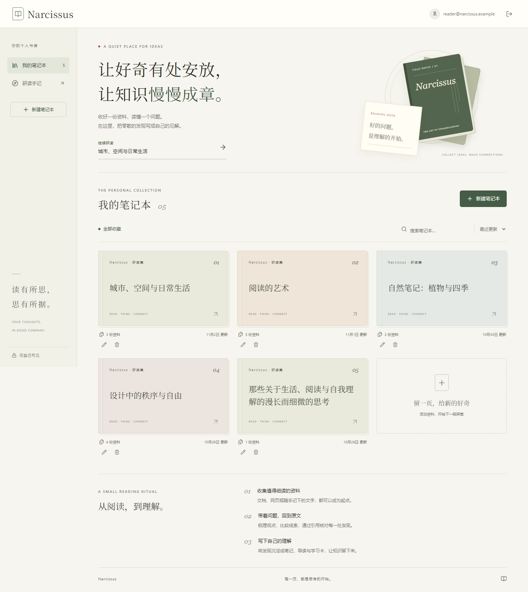
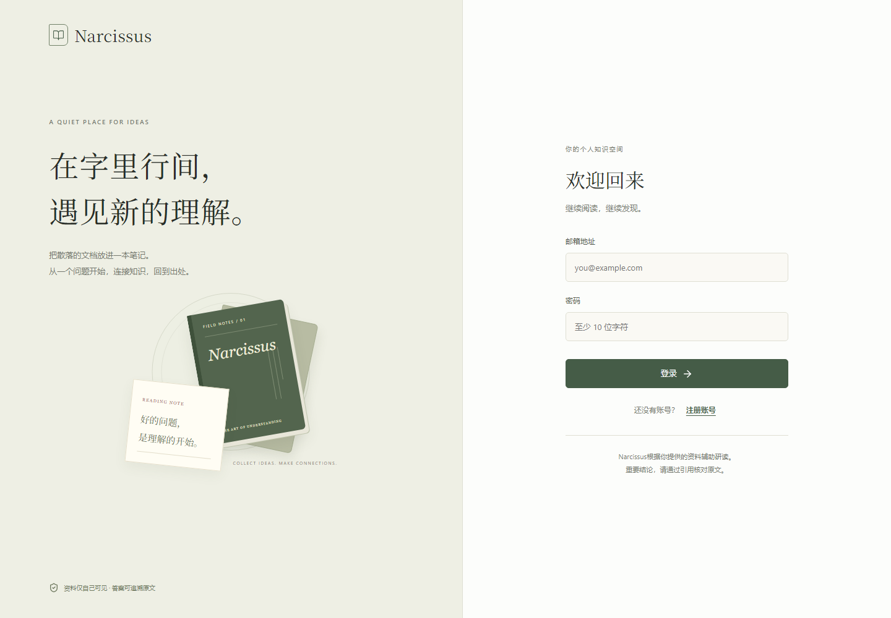
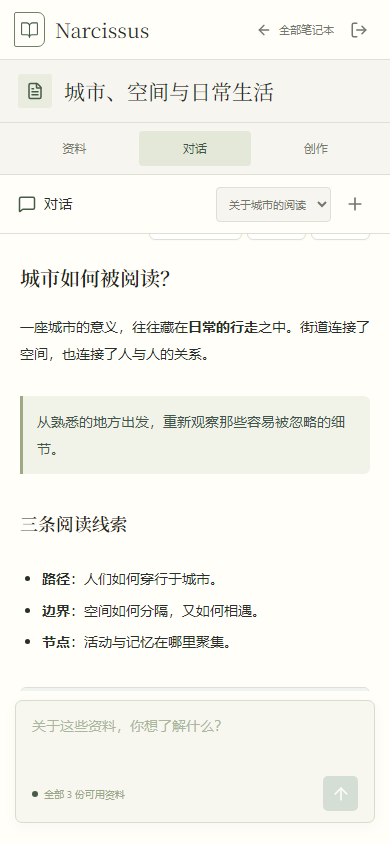

# 纸感编辑风改版

2026-11-04

## 界面

- 暖白纸面、墨绿与低饱和封面色，中文衬线标题、细分隔线与留白。
- 新版个人书房首页、笔记本封面、登录/注册页；统一资料、对话和创作工作区。
- CSS 书册插画，无新增外部图片依赖；移除旧开场等待动画。
- 笔记本搜索、排序、分页、新建和重命名；手机端资料、对话和创作分栏切换。
- 保留 Markdown 阅读排版和 PDF 按需加载。

## 验证

Docker 中 `npm run build` 与 TypeScript 检查通过。部署使用：

```sh
docker compose --progress plain up -d --build --no-deps web
```

在已经配置模型的本地环境中，首页返回 HTTP 200；`/api/ready` 返回 HTTP 200 与 `{"status":"ready","models_configured":true}`。这不保证新安装环境已配置模型。

生产前端通过 20 项隔离浏览器检查，包括搜索、空结果、新建、重命名、Escape 关闭弹窗、手机分栏、提问建议、Markdown 排版以及登录/注册切换。检查覆盖 320、390、768、1024 和 1440 像素宽度。11 个静态资源的 SHA-256 与容器内容一致，PDF 功能块未出现在首页初始资源中。

交互检查使用浏览器内模拟 API，未写入真实业务数据，也未验证模型生成质量。以下截图均为生产前端配合示例数据。


本次只重建 web。Docker Desktop 恢复后，按用户授权启动原有依赖容器；未重建数据库、对象存储或后端，未运行数据库迁移，数据卷保留。

## Narcissus 品牌与兼容验证

页面、元数据、包名、API 标识、源码与文档统一使用 Narcissus。旧项目文件、旧品牌截图和无用的抓取素材已从当前版本移除。

改名后重新完成生产构建、20 项浏览器检查、9 项后端单元测试，以及 4 项代理检查：有效应用标识可到达鉴权层；缺失或错误标识、错误 Origin 仍被拒绝。后端单元测试在无网络、无业务卷的临时容器中执行。现有后端未重启，前端通过私有运行参数兼容其标识。






